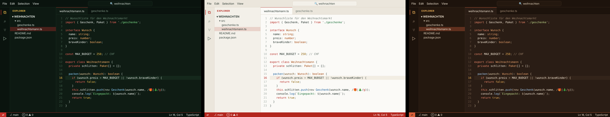
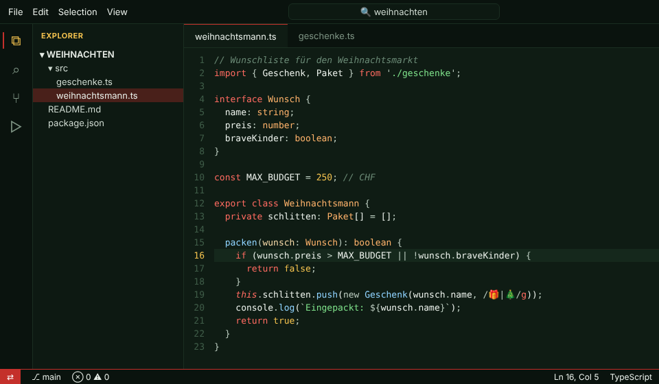
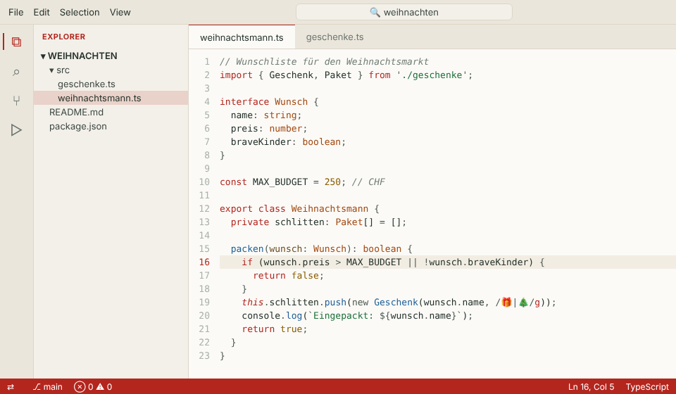
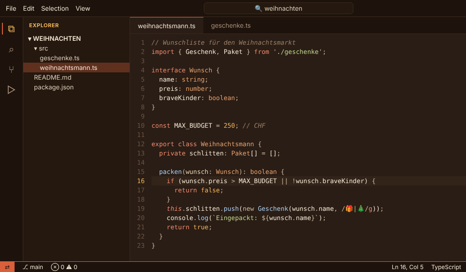

<p align="center">
  
</p>

<h1 align="center">Weihnachten Theme 🎄</h1>

<p align="center">
  Three cozy Christmas color themes for VS Code: dark pine green, fresh snow and warm gingerbread.
</p>

<p align="center">
  <a href="https://github.com/ric3-12/vscode-weihnachten-theme/issues/new?labels=bug&template=bug_report.md&title=">Report a Bug</a>
  ·
  <a href="https://github.com/ric3-12/vscode-weihnachten-theme/issues/new?labels=enhancement&template=feature_request.md&title=">Request feature</a>
</p>



## Table of Contents

- [Installation](#installation)
- [The variants](#the-variants)
- [Using the theme](#using-the-theme)
- [Pair it with Christmas lights](#pair-it-with-christmas-lights)
- [Deutsch](#deutsch)
- [Credits](#credits)
- [Thank you](#thank-you)

## Installation

Install this extension from the [VS Code Marketplace](https://marketplace.visualstudio.com/items?itemName=ric3.weihnachten-theme).

**OR**

With VS Code open, search for `Weihnachten Theme` in the extension panel (`Ctrl+Shift+X` on Windows/Linux or `Cmd(⌘)+Shift+X` on macOS) and click install.

**OR**

With VS Code open, launch VS Code Quick Open (`Ctrl+P` on Windows/Linux or `Cmd(⌘)+P` on macOS), paste the following command, and press enter.

```
ext install ric3.weihnachten-theme
```

## The variants

### Weihnachten Tannengrün (dark)

Deep pine green with Christmas red, gold and a touch of ice blue.



### Weihnachten Schnee (light)

Snow white with berry red, fir green and warm brown. Made for bright rooms and daytime coding.



### Weihnachten Lebkuchen (warm dark)

Gingerbread brown with cinnamon, honey, pistachio and icing blue.



All syntax colors meet a contrast ratio of at least 4.5:1 against the editor background (WCAG AA), comments at least 3:1.

## Using the theme

After installing, open the color theme picker with `Ctrl+K Ctrl+T` on Windows/Linux or `Cmd(⌘)+K Cmd(⌘)+T` on macOS and choose one of the **Weihnachten** variants.

Want VS Code to switch between light and dark automatically with your system? Add this to your `settings.json`:

```json
"window.autoDetectColorScheme": true,
"workbench.preferredDarkColorTheme": "Weihnachten Tannengrün",
"workbench.preferredLightColorTheme": "Weihnachten Schnee"
```

## Pair it with Christmas lights

Hang a string of pulsing pixel-art lights in your title bar with the companion extension [Weihnachtslichter](https://marketplace.visualstudio.com/items?itemName=ric3.weihnachtslichter) ([GitHub](https://github.com/ric3-12/vscode-extension-christmaslights)).

## Deutsch

Drei weihnachtliche Farbschemas für VS Code:

| Variante | Stil |
| --- | --- |
| **Weihnachten Tannengrün** | dunkles Tannengrün mit Rot, Gold und Eisblau |
| **Weihnachten Schnee** | helles Schneeweiss mit Beerenrot, Tannengrün und Braun |
| **Weihnachten Lebkuchen** | warmes Lebkuchenbraun mit Zimt, Honig, Pistazie und Zuckerguss-Blau |

Auswählen mit `Ctrl+K Ctrl+T` → eine der **Weihnachten**-Varianten. Passend dazu gibt es die Lichterkette [Weihnachtslichter](https://marketplace.visualstudio.com/items?itemName=ric3.weihnachtslichter).

## Credits

Color themes, icon and previews by [ric3-12](https://github.com/ric3-12). The theme files are generated from color palettes with [`build/generate.py`](build/generate.py), which also checks the contrast of every syntax color. **Has been Coded with Claude as an experiment**

## Thank you

Thanks to all the [contributors](https://github.com/ric3-12/vscode-weihnachten-theme/graphs/contributors) to this project. Frohe Weihnachten! 🎄
